# Haris Ahmed
### Penetration Tester | VAPT | Cybersecurity Analyst

  
 

 

## 👨‍💻 About Me

- 🔐 Cybersecurity Analyst & Penetration Tester, hands-on with **Active Directory**, **cloud (AWS)**, and **web/mobile** attack surfaces
- 🎓 BS Computer Science — NED University of Engineering & Technology, Karachi (2020–2024)
- 🏆 **OSCP+** | **eCPPTv2** | Offensive Python Developer (Coursera) | Aptech Software Engineering Diploma
- 🧪 Constantly building and breaking labs: custom Active Directory ranges with **BloodHound CE**, **NetExec**, **Impacket**, plus cloud pentesting environments
- 💼 Junior Penetration Tester experience, with a network/security background from an earlier role in pharma IT
- 🌍 Open to full-time, remote, and freelance offensive security work — active on Upwork
- 📫 Always happy to talk red teaming, AD attack chains, or cloud security — not a fan of a bare "hi" though 😄

 

## 🛠️ Skills & Tools

**Languages & Scripting**

**Offensive Security Tooling**

**Platforms & Infrastructure**

 

## 🏅 Some Certifications

 

## 🧠 Currently Exploring

- ⚔️ Advanced Active Directory attack chains — Kerberoasting, AS-REP roasting, RBCD, ACL abuse, DCSync, ADCS & delegation
- ☁️ Cloud security — AWS S3/IAM enumeration and privilege escalation paths
- 📱 Mobile app security — APK reverse engineering, Frida instrumentation, MobSF, certificate pinning bypasses

 

## 📌 Pinned Projects

GitHub will surface your pinned repos automatically right below this README. Worth pinning 4–6 of your strongest public ones — lab notes, tooling, or write-ups — so they lead with what a recruiter or client would actually want to see first.

 

## 📊 GitHub Stats

 

